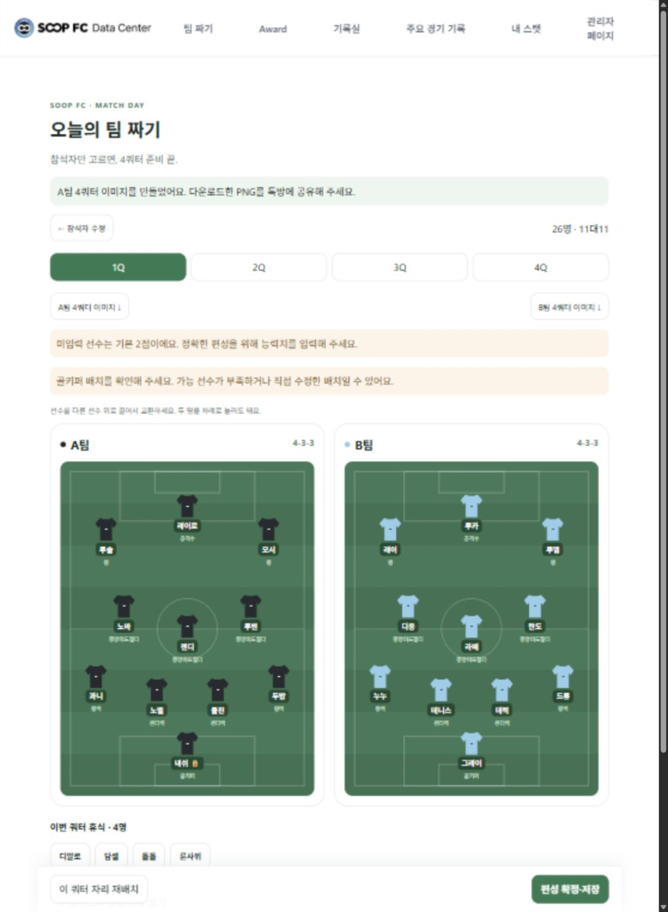
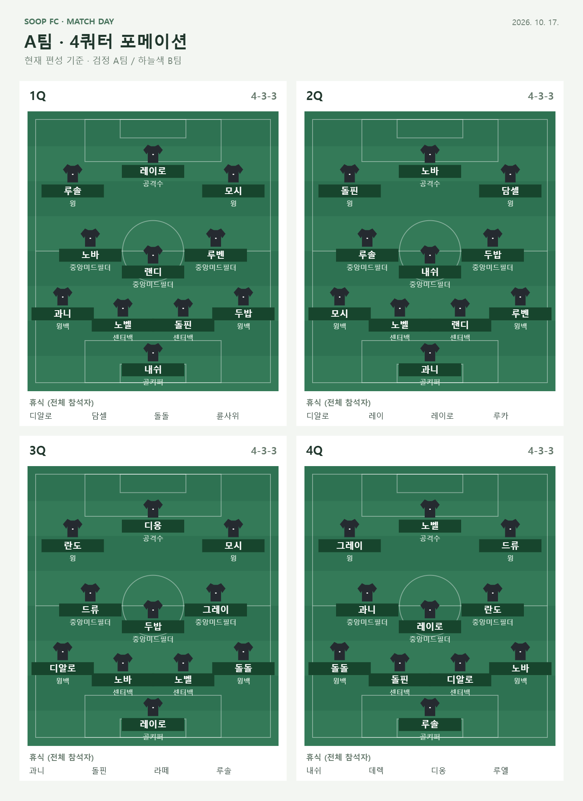

# 자동 팀 편성 — 첫 버전

주소: `/admin/formation`. 상단 ‘팀 짜기’와 관리자 메뉴에서 접근한다.

## 사용

1. 선수별 공격·수비·지능·피지컬(1~5), 선호 1·2순위, 골키퍼 가능 여부를 입력한다.
2. 이름을 검색해 선수를 누르면 참석자 목록에 추가된다. 목록에는 추가한 선수만 보이며 개별 제외와 능력치 수정이 가능하다. 최소 22명을 추가하고 편성한다. 미입력 능력치는 모두 2점으로 표시한다.
3. 4쿼터 탭으로 팀과 휴식 인원을 확인한다. 검정 A팀·하늘색 B팀 유니폼이 축구장 포메이션 좌표에 배치된다. 선수를 다른 선수 위로 드래그하면 교환한다. 터치 또는 키보드로 선수 두 명을 차례로 눌러도 교환할 수 있다. 같은 팀·상대 팀·휴식 선수 간 교환이 가능하며 고정한 선수는 보호된다. 모바일에서는 두 팀을 세로로 표시한다. 빈 공간으로 놓으면 변경되지 않는다.
4. 선수를 선택해 고정할 수 있다. ‘이 쿼터 자리 재배치’는 현재 팀·휴식 인원을 유지하고 고정한 자리를 보존한다.
5. 능력치와 편성의 DB 저장은 각각 명시적인 저장 버튼으로 실행한다. 편집 중 내용은 브라우저 localStorage에 임시 저장된다.

## 데이터

- 기존 `players`는 읽기만 한다.
- `formationProfiles/{playerId}`: stats, statScale: 5, preferences, goalkeeper.
- 이전 10점 척도 데이터는 읽을 때 절반으로 반올림하여 1~5점으로 변환한다. 변환 결과는 능력치 DB 저장 시 반영하며 원격 DB를 자동 갱신하지 않는다.
- `formationPlans/{autoId}`: 4쿼터 슬롯, 휴식, 능력치 스냅샷, 편성 모드, 생성 시각. 저장 시 새 문서가 생성된다.
- 기존 live 라인업을 덮어쓰지 않는다. 기존 라인업으로 내보내기는 아직 구현하지 않았다.
- 배포 전 새 컬렉션의 읽기·쓰기 권한을 관리자 인증과 연결해야 한다. 이 화면 자체는 관리자 인증을 추가하지 않는다.

## 편성 기준과 한계

출전 횟수가 적은 선수를 먼저 선택해 88개의 출전 자리를 분배한다. 팀 재편성 시 200개 후보의 항목별 합계 차이와 골키퍼 분배를 비교한다. 세 포메이션 후보에 선호 포지션과 가중 능력치를 적용한다. 이는 근사 탐색이며 최적해를 보장하지 않는다.

22명 초과 시 ‘팀 최대한 유지’는 균등 출전을 우선하므로 팀 이동이 발생할 수 있다. 연속 휴식·동료 다양성의 별도 최적화, 당일 출전 제한, 모임 간 출전 이력 반영은 아직 없다. 수동으로 휴식 선수를 교환하면 균등 출전이 깨질 수 있으므로 출전 횟수를 확인한다.

설명은 계산 기준을 보여주는 기본 설명이다. 생성형 AI API, 키를 보호하는 서버, AI 전술 설명은 아직 연결하지 않았다. 새 DB 저장의 실제 권한은 운영 Firebase 규칙에 따라 달라진다.

## 검증

`npm test -- --watchAll=false --runInBand --testPathPattern=formationEngine`

22·23·26·35·50명에 대해 쿼터별 중복·누락, 11명씩 배치, 출전 횟수 차이, 골키퍼 분배, 22명 팀 유지와 최소 인원을 검증한다.

## 톡방 공유 이미지

편성 결과 상단에서 A팀 또는 B팀의 4쿼터 이미지를 PNG로 다운로드할 수 있다. 현재 수동 수정까지 반영한 슬롯을 2×2 축구장으로 그리며 각 쿼터의 포메이션·이름·포지션과 전체 휴식 명단을 포함한다. 이미지 생성은 브라우저 안에서 수행하고 DB 저장이나 외부 AI 호출은 하지 않는다. 날짜는 다운로드 시점의 한국 날짜다.

## 화면 예시

26명을 선택해 만든 로컬 편성 예시다. 이미지에 보이는 배치는 테스트용이며 DB에 확정 저장하지 않았다.

