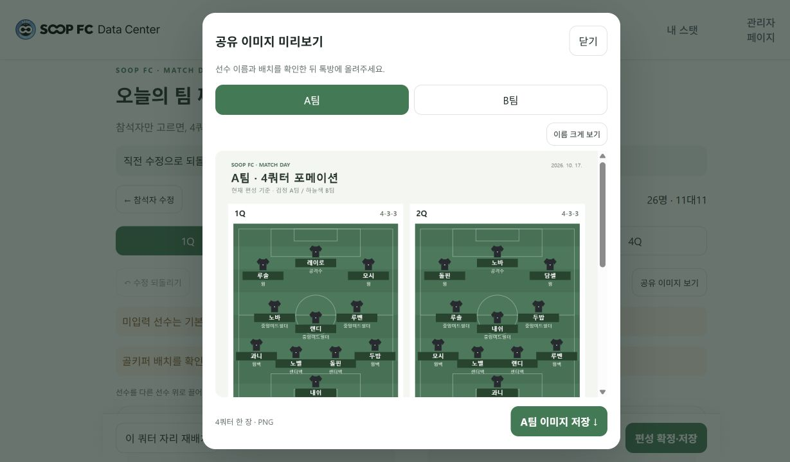
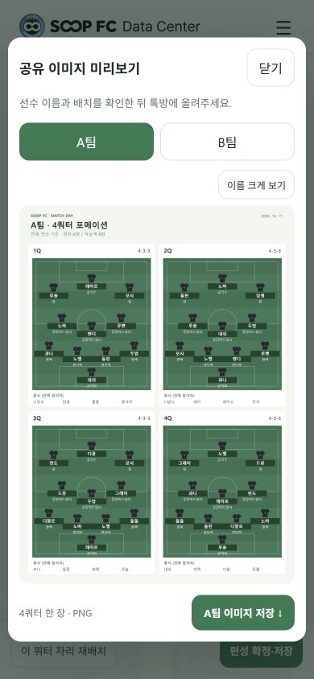
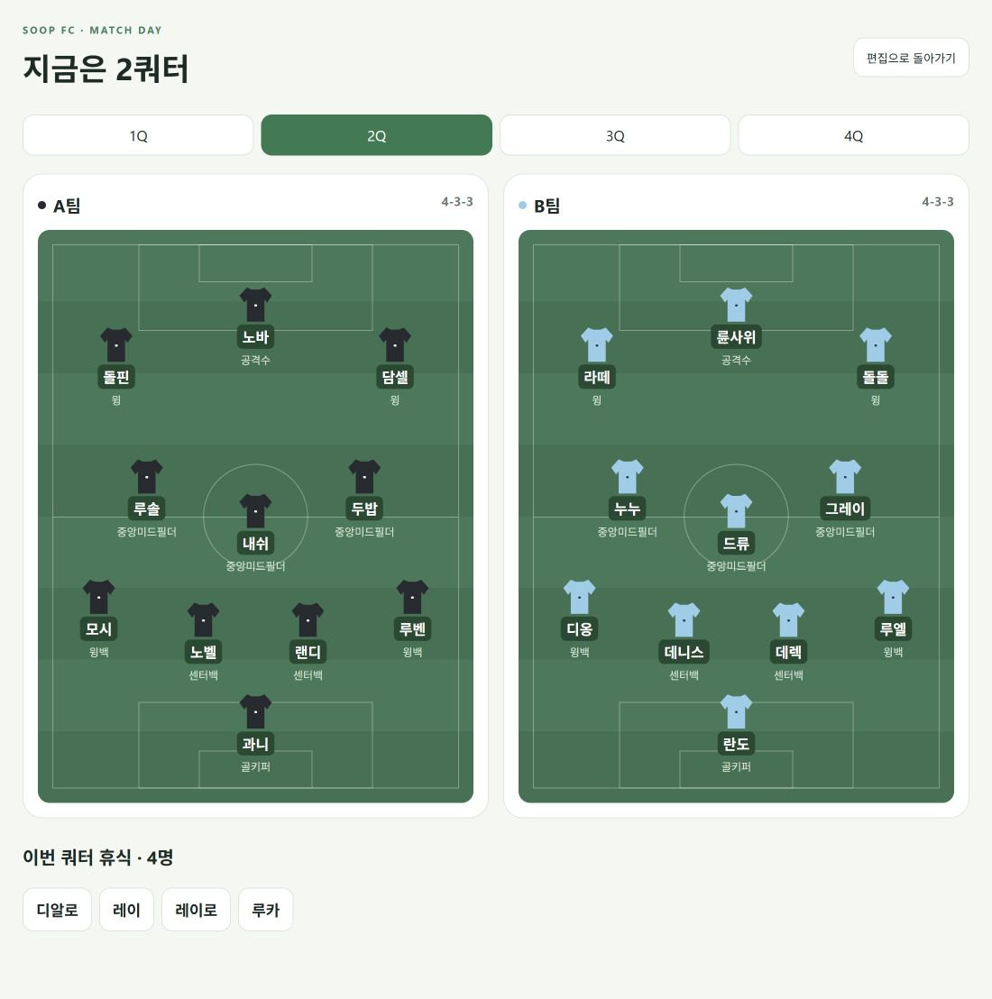

# 자동 팀 편성 — 첫 버전

주소: `/admin/formation`. 상단 ‘팀 짜기’와 관리자 메뉴에서 접근한다.

## 사용

1. 선수별 공격·수비·지능·피지컬(1~5), 선호 1·2순위, 골키퍼 가능 여부를 입력한다.
2. 이름을 검색해 선수를 누르면 참석자 목록에 추가된다. 목록에는 추가한 선수만 보이며 개별 제외와 능력치 수정이 가능하다. 최소 22명을 추가하고 편성한다. 미입력 능력치는 모두 2점으로 표시한다.
3. 4쿼터 탭으로 팀과 휴식 인원을 확인한다. 검정 A팀·하늘색 B팀 유니폼이 축구장 포메이션 좌표에 배치된다. 선수를 다른 선수 위로 드래그하면 교환한다. 터치 또는 키보드로 선수 두 명을 차례로 눌러도 교환할 수 있다. 같은 팀·상대 팀·휴식 선수 간 교환이 가능하며 고정한 선수는 보호된다. 모바일에서는 두 팀을 세로로 표시한다. 빈 공간으로 놓으면 변경되지 않는다.
4. 선수를 선택해 고정할 수 있다. ‘이 쿼터 자리 재배치’는 현재 팀·휴식 인원을 유지하고 고정한 자리를 보존한다.
5. 능력치와 편성의 DB 저장은 각각 명시적인 저장 버튼으로 실행한다. 편집 중 내용은 브라우저 localStorage에 임시 저장된다.
6. ‘수정 되돌리기’는 선수 교환·고정·자리 재배치를 최근 20번까지 되돌린다. 다른 쿼터에서 누르면 수정했던 쿼터로 돌아간다. 되돌리기 이력은 새 편성·참석자 수정·새로고침 시 초기화된다.
7. ‘지난 명단 불러오기’는 이 기기에서 최근 자동 편성한 명단을 현재 참석자에 추가한다. 중복과 삭제된 선수는 제외하며 현재 선택은 유지한다. DB 명단 조회 기능은 아니다.
8. 참석자별 ‘출전 설정’은 기본적으로 1~4Q가 모두 켜져 있다. 못 뛰는 쿼터만 끈다. 출전 불가는 휴식과 별도로 표시하며 편성·내보내기에 반영한다. 쿼터별 가능한 인원이 22명 미만이면 편성을 막고 부족 인원을 알려준다. 당일 설정은 기기에 한국 날짜와 함께 보관하며 다음 날짜에 화면을 다시 열면 초기화된다. 선수 기본 능력치에는 저장하지 않는다.
9. 결과의 A/B팀 포메이션 선택에서 자동 추천·4-3-3·4-4-2·4-2-3-1을 고른다. 기본은 현재 쿼터이며 체크박스로 해당 팀의 전체 쿼터에 적용할 수 있다. 팀원·휴식 인원은 유지하고 고정 선수는 같은 포지션을 유지한다. 새 포메이션의 자리가 부족하면 적용하지 않으며 전체 쿼터 변경도 부분 적용하지 않는다. 변경은 되돌리기 대상이다.
10. ‘경기 당일 보기’는 편집 버튼을 숨기고 큰 이름·포메이션·휴식/참여 불가 명단을 보여준다. 이전·다음 쿼터와 직접 쿼터 선택을 지원하고 편집으로 돌아가도 기존 편성은 유지한다. 이 보기 전환은 DB 저장과 별개다.
11. ‘+ 용병 추가’에서 이름만 입력하면 당일 참석자로 추가된다. 추가 설정에서 기본 2점의 능력치·선호 포지션·골키퍼 가능 여부를 바꿀 수 있으며 추가 후에는 회원과 같은 출전 설정을 사용한다. 이름이 겹치면 구분 가능한 별칭을 요청한다. 용병 목록은 한국 날짜 기준 이 기기에 당일 보관되며 확정 편성에는 이름·능력치·용병 여부가 스냅샷으로 남는다. `players`나 회원 능력치 문서는 만들지 않는다.
12. ‘직접 배치하기’는 1명 이상으로도 빈 편집을 시작할 수 있다. 빈자리를 누르면 출전 가능한 미배치 선수를 검색해 고르는 창이 열린다. PC에서는 대기 선수를 빈자리로 드래그할 수 있다. 배치된 선수를 눌러 ‘배치 해제’로 대기 명단으로 돌릴 수 있다. 고정된 선수는 먼저 고정을 해제한다.
13. ‘이 쿼터 빈자리 자동 채우기’는 직접 배치한 모든 선수를 유지한다. ‘나머지 쿼터 자동 완성’은 현재 쿼터와 이미 완성한 쿼터를 유지하고 나머지의 빈자리만 채운다. 대상 쿼터의 출전 가능 인원이 22명 미만이면 변경하지 않는다. 자동 완성한 슬롯끼리만 교환을 탐색해 밸런스와 포지션 적합도를 개선하며 최적해를 보장하지 않는다.
14. ‘이 쿼터 복사하기’에서 대상 쿼터를 선택하고 덮어쓰기 내용을 확인한 뒤 적용한다. 대상 쿼터에 출전 불가인 선수는 빈자리로 남는다. 복사와 배치 해제·자동 완성은 되돌릴 수 있다. 미완성 쿼터의 남은 선수는 ‘배치 대기’, 완성 쿼터에서는 ‘휴식’으로 표시한다. 미완성 편집은 자동 임시 보관하며 4쿼터를 모두 채워야 확정·공유·경기 당일 보기가 가능하다.

## 데이터

- 기존 `players`는 읽기만 한다.
- `formationProfiles/{playerId}`: stats, statScale: 5, preferences, goalkeeper.
- 이전 10점 척도 데이터는 읽을 때 절반으로 반올림하여 1~5점으로 변환한다. 변환 결과는 능력치 DB 저장 시 반영하며 원격 DB를 자동 갱신하지 않는다.
- `formationPlans/{autoId}`: 4쿼터 슬롯, 휴식, 능력치 스냅샷, 편성 모드, 생성 시각. 저장 시 새 문서가 생성된다.
- 기존 live 라인업을 덮어쓰지 않는다. 기존 라인업으로 내보내기는 아직 구현하지 않았다.
- 배포 전 새 컬렉션의 읽기·쓰기 권한을 관리자 인증과 연결해야 한다. 이 화면 자체는 관리자 인증을 추가하지 않는다.

## 편성 기준과 한계

출전 횟수가 적은 선수를 먼저 선택해 88개의 출전 자리를 분배한다. 팀 재편성 시 200개 후보의 항목별 합계 차이와 골키퍼 분배를 비교한다. 세 포메이션 후보에 선호 포지션과 가중 능력치를 적용한다. 이는 근사 탐색이며 최적해를 보장하지 않는다.

22명 초과 시 ‘팀 최대한 유지’는 균등 출전을 우선하므로 팀 이동이 발생할 수 있다. 출전 가능 쿼터를 먼저 지키고 가능한 선수 중 출전 횟수가 적은 선수를 우선 배정한다. 출전 조건이 다르면 전체 출전 횟수가 같지 않을 수 있다. 연속 휴식·동료 다양성의 별도 최적화와 모임 간 출전 이력 반영은 아직 없다. 수동으로 휴식 선수를 교환하면 균등 출전이 깨질 수 있으므로 출전 횟수를 확인한다.

설명은 계산 기준을 보여주는 기본 설명이다. 생성형 AI API, 키를 보호하는 서버, AI 전술 설명은 아직 연결하지 않았다. 새 DB 저장의 실제 권한은 운영 Firebase 규칙에 따라 달라진다.

## 검증

`npm test -- --watchAll=false --runInBand --runTestsByPath src/formationEngine.test.js src/manualFormation.test.js src/pages/Formation.test.js`

22·23·26·35·50명에 대해 쿼터별 중복·누락, 11명씩 배치, 출전 횟수 차이, 골키퍼 분배, 22명 팀 유지와 최소 인원을 검증한다.
UI 회귀 테스트는 쿼터 간 되돌리기, A/B 공유 미리보기와 명시적 다운로드, 최근 명단의 중복·삭제 선수 처리를 검증한다.
추가 테스트는 출전 불가 선수 제외·쿼터 인원 부족, 전체 쿼터 포메이션 변경과 고정 포지션 충돌 시 원자적 거부, 포메이션 변경 되돌리기, 경기 당일 보기와 쿼터 이동을 검증한다. 용병 추가, 수동 배치·해제·중복 거부, 드래그 빈자리 배치, 직접 배치를 유지한 자동 완성, 출전 불가 선수의 복사 제외 및 미완성 공유 차단까지 총 31개 테스트를 수행한다.

## 톡방 공유 이미지

편성 결과 상단의 ‘공유 이미지 보기’로 미리보기를 열고 A/B팀을 전환하여 확인한 뒤 ‘이미지 저장’을 누른다. ‘이름 크게 보기’로 확대해 이름과 배치를 확인할 수 있다. 현재 수동 수정까지 반영한 슬롯을 2×2 축구장으로 그리며 각 쿼터의 포메이션·이름·포지션과 전체 휴식 명단을 포함한다. 이미지 생성은 브라우저 안에서 수행하고 DB 저장이나 외부 AI 호출은 하지 않는다. 날짜는 다운로드 시점의 한국 날짜다.

## 화면 예시

26명을 선택해 만든 로컬 편성 예시다. 이미지에 보이는 배치는 테스트용이며 DB에 확정 저장하지 않았다.

